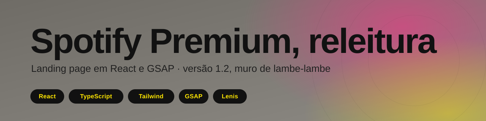
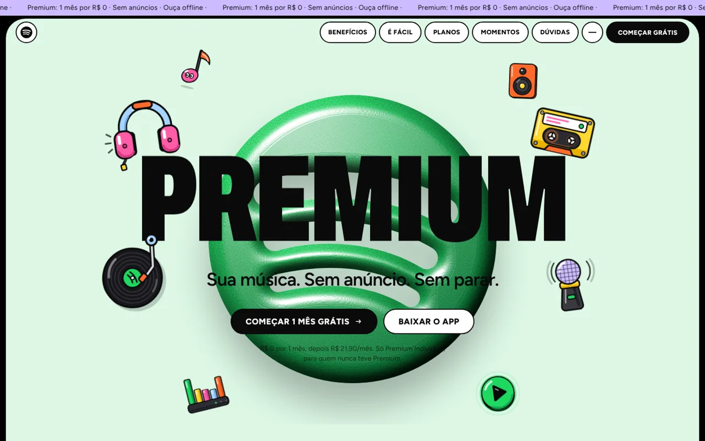

<div align="center">



<br>

<a href="https://spotifyrework.vercel.app/"></a>

<br>


<br>

<sub>

**[Sobre](#-sobre)** &nbsp;·&nbsp; **[Destaques](#-destaques)** &nbsp;·&nbsp; **[Tecnologias](#-tecnologias)** &nbsp;·&nbsp; **[Rodando](#-rodando-localmente)** &nbsp;·&nbsp; **[Estrutura](#-estrutura)** &nbsp;·&nbsp; **[Versões](#-versões)** &nbsp;·&nbsp; **[Observações](#-observações)**

</sub>

</div>

<br>

<div align="center">
  <a href="https://spotifyrework.vercel.app/">
    
  </a>
</div>

<br>

## ◆ Sobre

Releitura da landing page do **Spotify Premium (Brasil)**, feita como projeto de portfólio para exercitar front-end e movimento. A página vira um **muro de lambe-lambe**: cada oferta, recurso e plano é um cartaz colado sobre o anterior, com fita, cores fortes (rosa, amarelo e verde) e tipografia de cartaz.

**Acesse:** [spotifyrework.vercel.app](https://spotifyrework.vercel.app/)

As decisões de design estão registradas em [`DESIGN.md`](DESIGN.md) e [`PRODUCT.md`](PRODUCT.md), e o mapa do sistema de movimento está em [`docs/motion-map.md`](docs/motion-map.md).

## ◆ Destaques

- **Hero com o símbolo do Spotify em volume** e objetos ilustrados (fone, vinil, fita, microfone) que entram junto com o título
- **Sistema de movimento** com GSAP (ScrollTrigger e SplitText) e rolagem suave com Lenis
- **Seções em cartaz:** benefícios, "é fácil", planos, momentos, dúvidas frequentes e chamadas finais, todas no mesmo estilo
- **Planos** Individual, Duo, Família e Universitário, cada um com seu objeto e sua cor
- **Acessível:** contraste revisado nos destaques e suporte a `prefers-reduced-motion`
- **Responsivo**, com animações que pausam fora da tela

## ◆ Tecnologias

| Tecnologia | Uso |
| --- | --- |
| React 19 e TypeScript | Componentes e tipagem |
| Vite 7 | Servidor de desenvolvimento e build |
| Tailwind CSS 4 | Estilização e tokens de design |
| GSAP 3 | Animações e animações de scroll |
| Lenis | Rolagem suave |
| Archivo e Figtree | Tipografia (variáveis, via Fontsource) |

## ◆ Rodando localmente

Requer Node.js 20 ou superior.

```bash
git clone https://github.com/gabrielnovaesdev/SpotifyRework.git
cd SpotifyRework
npm install
npm run dev       # http://localhost:5173
npm run build     # confere os tipos e gera dist/
npm run preview   # serve dist/ para conferência
```

## ◆ Estrutura

```text
├── index.html
├── public/                 Imagens, ícones e vídeo do mascote
├── docs/                   Mapa de movimento e notas de revisão
├── tools/motion-recorder/  Grava o movimento da página para análise
└── src/
    ├── App.tsx             Montagem das seções
    ├── components/         Hero, Nav, Plans, Faq, Footer e demais seções
    ├── hooks/              Lenis, pausa fora da tela, salto de quadros
    ├── motion.ts           Sistema de movimento
    └── media.ts            Mídia externa usada pelas seções
```

## ◆ Versões

| Versão | O que é |
| --- | --- |
| **1.2** (esta, no `main`) | Releitura como muro de lambe-lambe, em React, TypeScript, Tailwind e GSAP |
| 1.0 | A primeira versão, em HTML, CSS e Bootstrap 3 (branch [`v1.0`](https://github.com/gabrielnovaesdev/SpotifyRework/tree/v1.0)) |

## ◆ Observações

- **Projeto educacional.** Feito apenas para estudo e portfólio, sem vínculo oficial com o Spotify. Marca, nome e identidade visual pertencem à **Spotify AB**.
- **Preços e ofertas são de referência.** Os valores dos planos e o "1 mês grátis" ilustram a página e não valem como oferta real. Os botões de assinatura e download abrem as páginas oficiais do Spotify em outra aba, e a oferta válida é sempre a de lá.
- **Algumas mídias vêm do servidor de marketing do Spotify.** As fotos da seção "Momentos" são carregadas de lá, e ficam centralizadas em [`src/media.ts`](src/media.ts) para serem trocadas por arquivos próprios sem mexer nos componentes. Se o endereço mudar, essas imagens podem deixar de carregar.
- **Movimento reduzido.** Com `prefers-reduced-motion: reduce` ativo no sistema, as animações são simplificadas.
- **Idioma.** Todo o conteúdo está em português do Brasil (`lang="pt-br"`).
- **Gravador de movimento.** [`tools/motion-recorder`](tools/motion-recorder/README.md) é uma ferramenta de apoio ao desenvolvimento (Node 22 ou superior e Chrome/Edge). Ela não faz parte do site, e as gravações vão para `.motion/`, que não é versionada.
- **Versão 1.0.** A versão em HTML puro continua disponível na branch `v1.0`, fora do `main`.

<br>

<div align="center"><sub>Feito por <a href="https://github.com/gabrielnovaesdev">Gabriel Novaes</a></sub></div>
